# OpenOcto

**One octopus ignites an entire ecosystem.**

## What it is

## The stack

## How it flows

## Why not ROS?

---

*Repositories, RFCs and releases live under the [OpenOctoLab](https://github.com/OpenOctoLab) GitHub organization · dual-licensed Apache-2.0 / MIT.*
